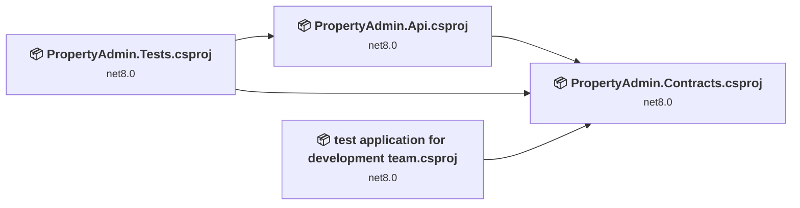
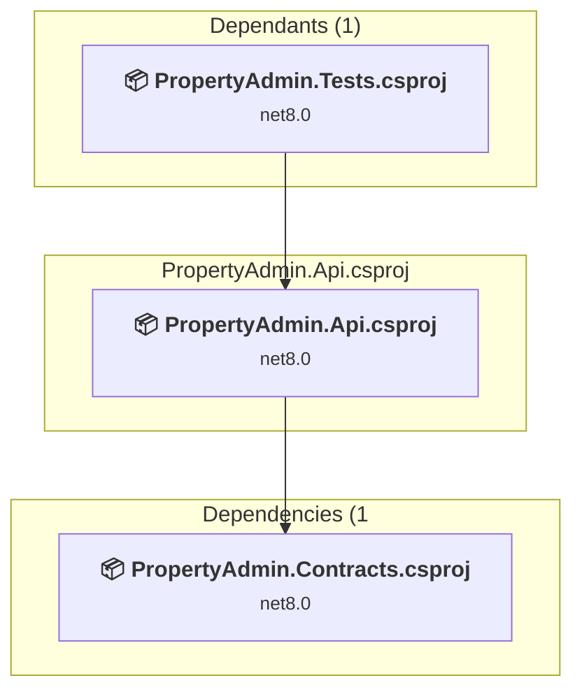
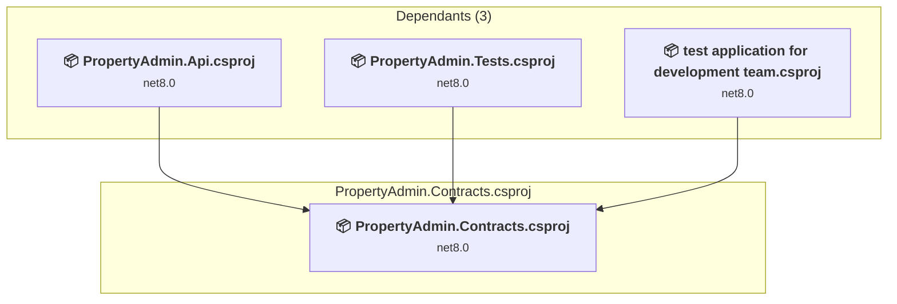
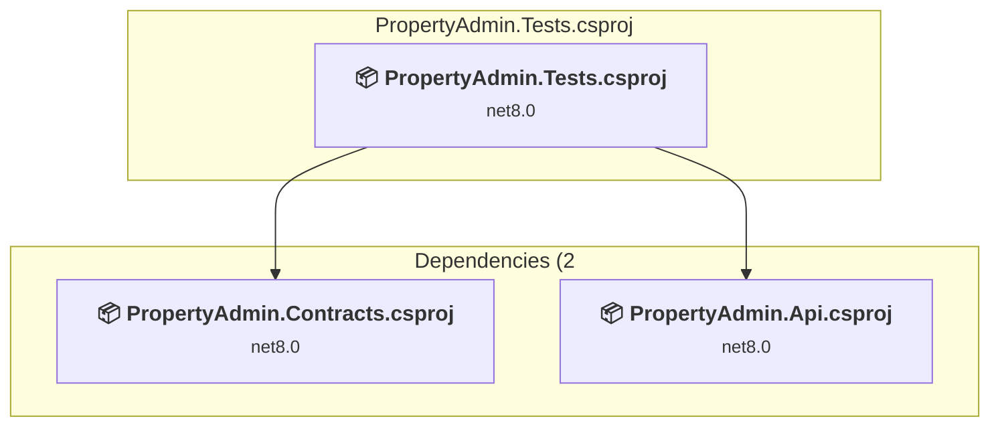
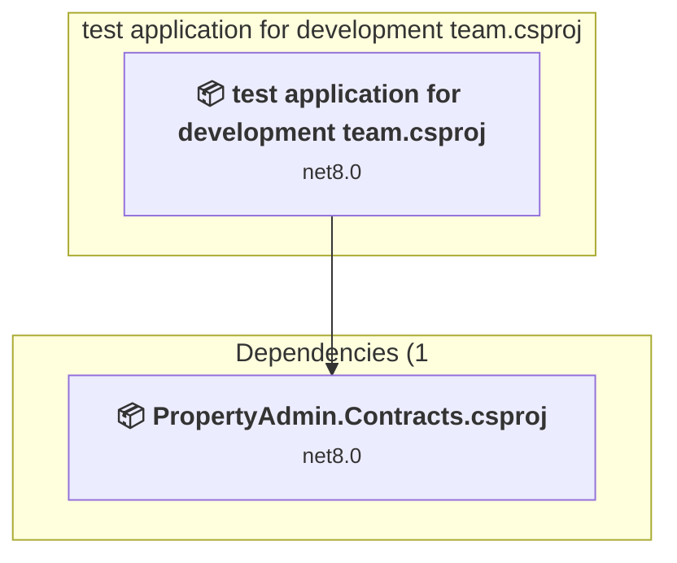

# Projects and dependencies analysis

This document provides a comprehensive overview of the projects and their dependencies in the context of upgrading to .NETCoreApp,Version=v10.0.

## Table of Contents

- [Executive Summary](#executive-Summary)
  - [Highlevel Metrics](#highlevel-metrics)
  - [Projects Compatibility](#projects-compatibility)
  - [Package Compatibility](#package-compatibility)
  - [API Compatibility](#api-compatibility)
  - [Binding Redirect Configuration](#binding-redirect-configuration)
- [Aggregate NuGet packages details](#aggregate-nuget-packages-details)
- [Top API Migration Challenges](#top-api-migration-challenges)
  - [Technologies and Features](#technologies-and-features)
  - [Most Frequent API Issues](#most-frequent-api-issues)
- [Projects Relationship Graph](#projects-relationship-graph)
- [Project Details](#project-details)

  - [PropertyAdmin.Api\PropertyAdmin.Api.csproj](#propertyadminapipropertyadminapicsproj)
  - [PropertyAdmin.Contracts\PropertyAdmin.Contracts.csproj](#propertyadmincontractspropertyadmincontractscsproj)
  - [PropertyAdmin.Tests\PropertyAdmin.Tests.csproj](#propertyadmintestspropertyadmintestscsproj)
  - [test application for development team\test application for development team.csproj](#test-application-for-development-teamtest-application-for-development-teamcsproj)

## Executive Summary

### Highlevel Metrics

| Metric | Count | Status |
| :--- | :---: | :--- |
| Total Projects | 4 | All require upgrade |
| Total NuGet Packages | 149 | 6 need upgrade |
| Total Code Files | 76 |  |
| Total Code Files with Incidents | 13 |  |
| Total Lines of Code | 5955 |  |
| Total Number of Issues | 88 |  |
| Estimated LOC to modify | 78+ | at least 1,3% of codebase |

### Projects Compatibility

| Project | Target Framework | Difficulty | Package Issues | API Issues | Binding Issues | Est. LOC Impact | Description |
| :--- | :---: | :---: | :---: | :---: | :---: | :---: | :--- |
| [PropertyAdmin.Api\PropertyAdmin.Api.csproj](#propertyadminapipropertyadminapicsproj) | net8.0 | 🟢 Low | 3 | 46 | 0 | 46+ | AspNetCore, Sdk Style = True |
| [PropertyAdmin.Contracts\PropertyAdmin.Contracts.csproj](#propertyadmincontractspropertyadmincontractscsproj) | net8.0 | 🟢 Low | 0 | 0 | 0 |  | ClassLibrary, Sdk Style = True |
| [PropertyAdmin.Tests\PropertyAdmin.Tests.csproj](#propertyadmintestspropertyadmintestscsproj) | net8.0 | 🟢 Low | 1 | 0 | 0 |  | DotNetCoreApp, Sdk Style = True |
| [test application for development team\test application for development team.csproj](#test-application-for-development-teamtest-application-for-development-teamcsproj) | net8.0 | 🟢 Low | 2 | 32 | 0 | 32+ | AspNetCore, Sdk Style = True |

### Package Compatibility

| Status | Count | Percentage |
| :--- | :---: | :---: |
| ✅ Compatible | 143 | 96,0% |
| ⚠️ Incompatible | 3 | 2,0% |
| 🔄 Upgrade Recommended | 3 | 2,0% |
| ***Total NuGet Packages*** | ***149*** | ***100%*** |

### API Compatibility

| Category | Count | Impact |
| :--- | :---: | :--- |
| 🔴 Binary Incompatible | 36 | High - Require code changes |
| 🟡 Source Incompatible | 19 | Medium - Needs re-compilation and potential conflicting API error fixing |
| 🔵 Behavioral change | 23 | Low - Behavioral changes that may require testing at runtime |
| ✅ Compatible | 28533 |  |
| ***Total APIs Analyzed*** | ***28611*** |  |

## Aggregate NuGet packages details

| Package | Current Version | Suggested Version | Projects | Description |
| :--- | :---: | :---: | :--- | :--- |
| coverlet.collector | 6.0.0 |  | [PropertyAdmin.Tests.csproj](#propertyadmintestspropertyadmintestscsproj) | ✅Compatible |
| Humanizer.Core | 2.14.1 |  | [PropertyAdmin.Api.csproj](#propertyadminapipropertyadminapicsproj) | ✅Compatible |
| Microsoft.AspNetCore.Authentication.JwtBearer | 8.0.11 | 10.0.14 | [PropertyAdmin.Api.csproj](#propertyadminapipropertyadminapicsproj) [PropertyAdmin.Tests.csproj](#propertyadmintestspropertyadmintestscsproj) | NuGet package upgrade is recommended |
| Microsoft.AspNetCore.Cryptography.Internal | 8.0.11 |  | [PropertyAdmin.Api.csproj](#propertyadminapipropertyadminapicsproj) [PropertyAdmin.Tests.csproj](#propertyadmintestspropertyadmintestscsproj) | ✅Compatible |
| Microsoft.AspNetCore.Cryptography.KeyDerivation | 8.0.11 |  | [PropertyAdmin.Api.csproj](#propertyadminapipropertyadminapicsproj) [PropertyAdmin.Tests.csproj](#propertyadmintestspropertyadmintestscsproj) | ✅Compatible |
| Microsoft.AspNetCore.Identity.EntityFrameworkCore | 8.0.11 | 10.0.14 | [PropertyAdmin.Api.csproj](#propertyadminapipropertyadminapicsproj) [PropertyAdmin.Tests.csproj](#propertyadmintestspropertyadmintestscsproj) | NuGet package upgrade is recommended |
| Microsoft.Bcl.AsyncInterfaces | 6.0.0 |  | [PropertyAdmin.Api.csproj](#propertyadminapipropertyadminapicsproj) | ✅Compatible |
| Microsoft.CodeAnalysis.Analyzers | 3.3.3 |  | [PropertyAdmin.Api.csproj](#propertyadminapipropertyadminapicsproj) | ✅Compatible |
| Microsoft.CodeAnalysis.Common | 4.5.0 |  | [PropertyAdmin.Api.csproj](#propertyadminapipropertyadminapicsproj) | ✅Compatible |
| Microsoft.CodeAnalysis.CSharp | 4.5.0 |  | [PropertyAdmin.Api.csproj](#propertyadminapipropertyadminapicsproj) | ✅Compatible |
| Microsoft.CodeAnalysis.CSharp.Workspaces | 4.5.0 |  | [PropertyAdmin.Api.csproj](#propertyadminapipropertyadminapicsproj) | ✅Compatible |
| Microsoft.CodeAnalysis.Workspaces.Common | 4.5.0 |  | [PropertyAdmin.Api.csproj](#propertyadminapipropertyadminapicsproj) | ✅Compatible |
| Microsoft.CodeCoverage | 17.8.0 |  | [PropertyAdmin.Tests.csproj](#propertyadmintestspropertyadmintestscsproj) | ✅Compatible |
| Microsoft.EntityFrameworkCore | 8.0.11 |  | [PropertyAdmin.Api.csproj](#propertyadminapipropertyadminapicsproj) [PropertyAdmin.Tests.csproj](#propertyadmintestspropertyadmintestscsproj) | ✅Compatible |
| Microsoft.EntityFrameworkCore.Abstractions | 8.0.11 |  | [PropertyAdmin.Api.csproj](#propertyadminapipropertyadminapicsproj) [PropertyAdmin.Tests.csproj](#propertyadmintestspropertyadmintestscsproj) | ✅Compatible |
| Microsoft.EntityFrameworkCore.Analyzers | 8.0.11 |  | [PropertyAdmin.Api.csproj](#propertyadminapipropertyadminapicsproj) [PropertyAdmin.Tests.csproj](#propertyadmintestspropertyadmintestscsproj) | ✅Compatible |
| Microsoft.EntityFrameworkCore.Design | 8.0.11 | 10.0.14 | [PropertyAdmin.Api.csproj](#propertyadminapipropertyadminapicsproj) | NuGet package upgrade is recommended |
| Microsoft.EntityFrameworkCore.Relational | 8.0.11 |  | [PropertyAdmin.Api.csproj](#propertyadminapipropertyadminapicsproj) [PropertyAdmin.Tests.csproj](#propertyadmintestspropertyadmintestscsproj) | ✅Compatible |
| Microsoft.Extensions.ApiDescription.Server | 6.0.5 |  | [PropertyAdmin.Api.csproj](#propertyadminapipropertyadminapicsproj) [PropertyAdmin.Tests.csproj](#propertyadmintestspropertyadmintestscsproj) | ✅Compatible |
| Microsoft.Extensions.Caching.Abstractions | 8.0.0 |  | [PropertyAdmin.Api.csproj](#propertyadminapipropertyadminapicsproj) [PropertyAdmin.Tests.csproj](#propertyadmintestspropertyadmintestscsproj) | ✅Compatible |
| Microsoft.Extensions.Caching.Memory | 8.0.1 |  | [PropertyAdmin.Api.csproj](#propertyadminapipropertyadminapicsproj) [PropertyAdmin.Tests.csproj](#propertyadmintestspropertyadmintestscsproj) | ✅Compatible |
| Microsoft.Extensions.Configuration.Abstractions | 8.0.0 |  | [PropertyAdmin.Api.csproj](#propertyadminapipropertyadminapicsproj) [PropertyAdmin.Tests.csproj](#propertyadmintestspropertyadmintestscsproj) | ✅Compatible |
| Microsoft.Extensions.DependencyInjection | 8.0.1 |  | [PropertyAdmin.Api.csproj](#propertyadminapipropertyadminapicsproj) [PropertyAdmin.Tests.csproj](#propertyadmintestspropertyadmintestscsproj) | ✅Compatible |
| Microsoft.Extensions.DependencyInjection.Abstractions | 8.0.2 |  | [PropertyAdmin.Api.csproj](#propertyadminapipropertyadminapicsproj) [PropertyAdmin.Tests.csproj](#propertyadmintestspropertyadmintestscsproj) | ✅Compatible |
| Microsoft.Extensions.DependencyModel | 8.0.2 |  | [PropertyAdmin.Api.csproj](#propertyadminapipropertyadminapicsproj) | ✅Compatible |
| Microsoft.Extensions.Identity.Core | 8.0.11 |  | [PropertyAdmin.Api.csproj](#propertyadminapipropertyadminapicsproj) [PropertyAdmin.Tests.csproj](#propertyadmintestspropertyadmintestscsproj) | ✅Compatible |
| Microsoft.Extensions.Identity.Stores | 8.0.11 |  | [PropertyAdmin.Api.csproj](#propertyadminapipropertyadminapicsproj) [PropertyAdmin.Tests.csproj](#propertyadmintestspropertyadmintestscsproj) | ✅Compatible |
| Microsoft.Extensions.Logging | 8.0.1 |  | [PropertyAdmin.Api.csproj](#propertyadminapipropertyadminapicsproj) [PropertyAdmin.Tests.csproj](#propertyadmintestspropertyadmintestscsproj) | ✅Compatible |
| Microsoft.Extensions.Logging.Abstractions | 8.0.2 |  | [PropertyAdmin.Api.csproj](#propertyadminapipropertyadminapicsproj) [PropertyAdmin.Tests.csproj](#propertyadmintestspropertyadmintestscsproj) | ✅Compatible |
| Microsoft.Extensions.Options | 8.0.2 |  | [PropertyAdmin.Api.csproj](#propertyadminapipropertyadminapicsproj) [PropertyAdmin.Tests.csproj](#propertyadmintestspropertyadmintestscsproj) | ✅Compatible |
| Microsoft.Extensions.Primitives | 8.0.0 |  | [PropertyAdmin.Api.csproj](#propertyadminapipropertyadminapicsproj) [PropertyAdmin.Tests.csproj](#propertyadmintestspropertyadmintestscsproj) | ✅Compatible |
| Microsoft.IdentityModel.Abstractions | 7.1.2 |  | [PropertyAdmin.Api.csproj](#propertyadminapipropertyadminapicsproj) [PropertyAdmin.Tests.csproj](#propertyadmintestspropertyadmintestscsproj) [test application for development team.csproj](#test-application-for-development-teamtest-application-for-development-teamcsproj) | ✅Compatible |
| Microsoft.IdentityModel.JsonWebTokens | 7.1.2 |  | [PropertyAdmin.Api.csproj](#propertyadminapipropertyadminapicsproj) [PropertyAdmin.Tests.csproj](#propertyadmintestspropertyadmintestscsproj) [test application for development team.csproj](#test-application-for-development-teamtest-application-for-development-teamcsproj) | ✅Compatible |
| Microsoft.IdentityModel.Logging | 7.1.2 |  | [PropertyAdmin.Api.csproj](#propertyadminapipropertyadminapicsproj) [PropertyAdmin.Tests.csproj](#propertyadmintestspropertyadmintestscsproj) [test application for development team.csproj](#test-application-for-development-teamtest-application-for-development-teamcsproj) | ✅Compatible |
| Microsoft.IdentityModel.Protocols | 7.1.2 |  | [PropertyAdmin.Api.csproj](#propertyadminapipropertyadminapicsproj) [PropertyAdmin.Tests.csproj](#propertyadmintestspropertyadmintestscsproj) | ✅Compatible |
| Microsoft.IdentityModel.Protocols.OpenIdConnect | 7.1.2 |  | [PropertyAdmin.Api.csproj](#propertyadminapipropertyadminapicsproj) [PropertyAdmin.Tests.csproj](#propertyadmintestspropertyadmintestscsproj) | ✅Compatible |
| Microsoft.IdentityModel.Tokens | 7.1.2 |  | [PropertyAdmin.Api.csproj](#propertyadminapipropertyadminapicsproj) [PropertyAdmin.Tests.csproj](#propertyadmintestspropertyadmintestscsproj) [test application for development team.csproj](#test-application-for-development-teamtest-application-for-development-teamcsproj) | ✅Compatible |
| Microsoft.NET.Test.Sdk | 17.8.0 |  | [PropertyAdmin.Tests.csproj](#propertyadmintestspropertyadmintestscsproj) | ✅Compatible |
| Microsoft.NETCore.Platforms | 1.1.0 |  | [PropertyAdmin.Tests.csproj](#propertyadmintestspropertyadmintestscsproj) | ✅Compatible |
| Microsoft.NETCore.Targets | 1.1.0 |  | [PropertyAdmin.Tests.csproj](#propertyadmintestspropertyadmintestscsproj) | ✅Compatible |
| Microsoft.OpenApi | 1.6.14 |  | [PropertyAdmin.Api.csproj](#propertyadminapipropertyadminapicsproj) [PropertyAdmin.Tests.csproj](#propertyadmintestspropertyadmintestscsproj) | ✅Compatible |
| Microsoft.TestPlatform.ObjectModel | 17.8.0 |  | [PropertyAdmin.Tests.csproj](#propertyadmintestspropertyadmintestscsproj) | ✅Compatible |
| Microsoft.TestPlatform.TestHost | 17.8.0 |  | [PropertyAdmin.Tests.csproj](#propertyadmintestspropertyadmintestscsproj) | ✅Compatible |
| Microsoft.VisualStudio.Azure.Containers.Tools.Targets | 1.24.2-preview.1 |  | [test application for development team.csproj](#test-application-for-development-teamtest-application-for-development-teamcsproj) | ⚠️NuGet package is incompatible |
| Microsoft.Win32.Primitives | 4.3.0 |  | [PropertyAdmin.Tests.csproj](#propertyadmintestspropertyadmintestscsproj) | ✅Compatible |
| Mono.TextTemplating | 2.2.1 |  | [PropertyAdmin.Api.csproj](#propertyadminapipropertyadminapicsproj) | ✅Compatible |
| NETStandard.Library | 1.6.1 |  | [PropertyAdmin.Tests.csproj](#propertyadmintestspropertyadmintestscsproj) | ✅Compatible |
| Newtonsoft.Json | 13.0.1 |  | [PropertyAdmin.Tests.csproj](#propertyadmintestspropertyadmintestscsproj) | ✅Compatible |
| Npgsql | 8.0.6 |  | [PropertyAdmin.Api.csproj](#propertyadminapipropertyadminapicsproj) [PropertyAdmin.Tests.csproj](#propertyadmintestspropertyadmintestscsproj) | ✅Compatible |
| Npgsql.EntityFrameworkCore.PostgreSQL | 8.0.11 |  | [PropertyAdmin.Api.csproj](#propertyadminapipropertyadminapicsproj) [PropertyAdmin.Tests.csproj](#propertyadmintestspropertyadmintestscsproj) | ✅Compatible |
| NuGet.Frameworks | 6.5.0 |  | [PropertyAdmin.Tests.csproj](#propertyadmintestspropertyadmintestscsproj) | ✅Compatible |
| PDFsharp-MigraDoc | 6.1.1 |  | [PropertyAdmin.Api.csproj](#propertyadminapipropertyadminapicsproj) [PropertyAdmin.Tests.csproj](#propertyadmintestspropertyadmintestscsproj) | ✅Compatible |
| QRCoder | 1.6.0 |  | [test application for development team.csproj](#test-application-for-development-teamtest-application-for-development-teamcsproj) | ✅Compatible |
| runtime.debian.8-x64.runtime.native.System.Security.Cryptography.OpenSsl | 4.3.0 |  | [PropertyAdmin.Tests.csproj](#propertyadmintestspropertyadmintestscsproj) | ✅Compatible |
| runtime.fedora.23-x64.runtime.native.System.Security.Cryptography.OpenSsl | 4.3.0 |  | [PropertyAdmin.Tests.csproj](#propertyadmintestspropertyadmintestscsproj) | ✅Compatible |
| runtime.fedora.24-x64.runtime.native.System.Security.Cryptography.OpenSsl | 4.3.0 |  | [PropertyAdmin.Tests.csproj](#propertyadmintestspropertyadmintestscsproj) | ✅Compatible |
| runtime.native.System | 4.3.0 |  | [PropertyAdmin.Tests.csproj](#propertyadmintestspropertyadmintestscsproj) | ✅Compatible |
| runtime.native.System.IO.Compression | 4.3.0 |  | [PropertyAdmin.Tests.csproj](#propertyadmintestspropertyadmintestscsproj) | ✅Compatible |
| runtime.native.System.Net.Http | 4.3.0 |  | [PropertyAdmin.Tests.csproj](#propertyadmintestspropertyadmintestscsproj) | ✅Compatible |
| runtime.native.System.Security.Cryptography.Apple | 4.3.0 |  | [PropertyAdmin.Tests.csproj](#propertyadmintestspropertyadmintestscsproj) | ✅Compatible |
| runtime.native.System.Security.Cryptography.OpenSsl | 4.3.0 |  | [PropertyAdmin.Tests.csproj](#propertyadmintestspropertyadmintestscsproj) | ✅Compatible |
| runtime.opensuse.13.2-x64.runtime.native.System.Security.Cryptography.OpenSsl | 4.3.0 |  | [PropertyAdmin.Tests.csproj](#propertyadmintestspropertyadmintestscsproj) | ✅Compatible |
| runtime.opensuse.42.1-x64.runtime.native.System.Security.Cryptography.OpenSsl | 4.3.0 |  | [PropertyAdmin.Tests.csproj](#propertyadmintestspropertyadmintestscsproj) | ✅Compatible |
| runtime.osx.10.10-x64.runtime.native.System.Security.Cryptography.Apple | 4.3.0 |  | [PropertyAdmin.Tests.csproj](#propertyadmintestspropertyadmintestscsproj) | ✅Compatible |
| runtime.osx.10.10-x64.runtime.native.System.Security.Cryptography.OpenSsl | 4.3.0 |  | [PropertyAdmin.Tests.csproj](#propertyadmintestspropertyadmintestscsproj) | ✅Compatible |
| runtime.rhel.7-x64.runtime.native.System.Security.Cryptography.OpenSsl | 4.3.0 |  | [PropertyAdmin.Tests.csproj](#propertyadmintestspropertyadmintestscsproj) | ✅Compatible |
| runtime.ubuntu.14.04-x64.runtime.native.System.Security.Cryptography.OpenSsl | 4.3.0 |  | [PropertyAdmin.Tests.csproj](#propertyadmintestspropertyadmintestscsproj) | ✅Compatible |
| runtime.ubuntu.16.04-x64.runtime.native.System.Security.Cryptography.OpenSsl | 4.3.0 |  | [PropertyAdmin.Tests.csproj](#propertyadmintestspropertyadmintestscsproj) | ✅Compatible |
| runtime.ubuntu.16.10-x64.runtime.native.System.Security.Cryptography.OpenSsl | 4.3.0 |  | [PropertyAdmin.Tests.csproj](#propertyadmintestspropertyadmintestscsproj) | ✅Compatible |
| Swashbuckle.AspNetCore | 6.6.2 |  | [PropertyAdmin.Api.csproj](#propertyadminapipropertyadminapicsproj) [PropertyAdmin.Tests.csproj](#propertyadmintestspropertyadmintestscsproj) | ✅Compatible |
| Swashbuckle.AspNetCore.Swagger | 6.6.2 |  | [PropertyAdmin.Api.csproj](#propertyadminapipropertyadminapicsproj) [PropertyAdmin.Tests.csproj](#propertyadmintestspropertyadmintestscsproj) | ✅Compatible |
| Swashbuckle.AspNetCore.SwaggerGen | 6.6.2 |  | [PropertyAdmin.Api.csproj](#propertyadminapipropertyadminapicsproj) [PropertyAdmin.Tests.csproj](#propertyadmintestspropertyadmintestscsproj) | ✅Compatible |
| Swashbuckle.AspNetCore.SwaggerUI | 6.6.2 |  | [PropertyAdmin.Api.csproj](#propertyadminapipropertyadminapicsproj) [PropertyAdmin.Tests.csproj](#propertyadmintestspropertyadmintestscsproj) | ✅Compatible |
| System.AppContext | 4.3.0 |  | [PropertyAdmin.Tests.csproj](#propertyadmintestspropertyadmintestscsproj) | ✅Compatible |
| System.Buffers | 4.3.0 |  | [PropertyAdmin.Tests.csproj](#propertyadmintestspropertyadmintestscsproj) | ✅Compatible |
| System.CodeDom | 4.4.0 |  | [PropertyAdmin.Api.csproj](#propertyadminapipropertyadminapicsproj) | ✅Compatible |
| System.Collections | 4.3.0 |  | [PropertyAdmin.Tests.csproj](#propertyadmintestspropertyadmintestscsproj) | ✅Compatible |
| System.Collections.Concurrent | 4.3.0 |  | [PropertyAdmin.Tests.csproj](#propertyadmintestspropertyadmintestscsproj) | ✅Compatible |
| System.Collections.Immutable | 6.0.0 |  | [PropertyAdmin.Api.csproj](#propertyadminapipropertyadminapicsproj) | ✅Compatible |
| System.Composition | 6.0.0 |  | [PropertyAdmin.Api.csproj](#propertyadminapipropertyadminapicsproj) | ✅Compatible |
| System.Composition.AttributedModel | 6.0.0 |  | [PropertyAdmin.Api.csproj](#propertyadminapipropertyadminapicsproj) | ✅Compatible |
| System.Composition.Convention | 6.0.0 |  | [PropertyAdmin.Api.csproj](#propertyadminapipropertyadminapicsproj) | ✅Compatible |
| System.Composition.Hosting | 6.0.0 |  | [PropertyAdmin.Api.csproj](#propertyadminapipropertyadminapicsproj) | ✅Compatible |
| System.Composition.Runtime | 6.0.0 |  | [PropertyAdmin.Api.csproj](#propertyadminapipropertyadminapicsproj) | ✅Compatible |
| System.Composition.TypedParts | 6.0.0 |  | [PropertyAdmin.Api.csproj](#propertyadminapipropertyadminapicsproj) | ✅Compatible |
| System.Console | 4.3.0 |  | [PropertyAdmin.Tests.csproj](#propertyadmintestspropertyadmintestscsproj) | ✅Compatible |
| System.Diagnostics.Debug | 4.3.0 |  | [PropertyAdmin.Tests.csproj](#propertyadmintestspropertyadmintestscsproj) | ✅Compatible |
| System.Diagnostics.DiagnosticSource | 4.3.0 |  | [PropertyAdmin.Tests.csproj](#propertyadmintestspropertyadmintestscsproj) | ✅Compatible |
| System.Diagnostics.Tools | 4.3.0 |  | [PropertyAdmin.Tests.csproj](#propertyadmintestspropertyadmintestscsproj) | ✅Compatible |
| System.Diagnostics.Tracing | 4.3.0 |  | [PropertyAdmin.Tests.csproj](#propertyadmintestspropertyadmintestscsproj) | ✅Compatible |
| System.Globalization | 4.3.0 |  | [PropertyAdmin.Tests.csproj](#propertyadmintestspropertyadmintestscsproj) | ✅Compatible |
| System.Globalization.Calendars | 4.3.0 |  | [PropertyAdmin.Tests.csproj](#propertyadmintestspropertyadmintestscsproj) | ✅Compatible |
| System.Globalization.Extensions | 4.3.0 |  | [PropertyAdmin.Tests.csproj](#propertyadmintestspropertyadmintestscsproj) | ✅Compatible |
| System.IdentityModel.Tokens.Jwt | 7.1.2 |  | [PropertyAdmin.Api.csproj](#propertyadminapipropertyadminapicsproj) [PropertyAdmin.Tests.csproj](#propertyadmintestspropertyadmintestscsproj) [test application for development team.csproj](#test-application-for-development-teamtest-application-for-development-teamcsproj) | ⚠️NuGet package is deprecated |
| System.IO | 4.3.0 |  | [PropertyAdmin.Tests.csproj](#propertyadmintestspropertyadmintestscsproj) | ✅Compatible |
| System.IO.Compression | 4.3.0 |  | [PropertyAdmin.Tests.csproj](#propertyadmintestspropertyadmintestscsproj) | ✅Compatible |
| System.IO.Compression.ZipFile | 4.3.0 |  | [PropertyAdmin.Tests.csproj](#propertyadmintestspropertyadmintestscsproj) | ✅Compatible |
| System.IO.FileSystem | 4.3.0 |  | [PropertyAdmin.Tests.csproj](#propertyadmintestspropertyadmintestscsproj) | ✅Compatible |
| System.IO.FileSystem.Primitives | 4.3.0 |  | [PropertyAdmin.Tests.csproj](#propertyadmintestspropertyadmintestscsproj) | ✅Compatible |
| System.IO.Pipelines | 6.0.3 |  | [PropertyAdmin.Api.csproj](#propertyadminapipropertyadminapicsproj) | ✅Compatible |
| System.Linq | 4.3.0 |  | [PropertyAdmin.Tests.csproj](#propertyadmintestspropertyadmintestscsproj) | ✅Compatible |
| System.Linq.Expressions | 4.3.0 |  | [PropertyAdmin.Tests.csproj](#propertyadmintestspropertyadmintestscsproj) | ✅Compatible |
| System.Net.Http | 4.3.0 |  | [PropertyAdmin.Tests.csproj](#propertyadmintestspropertyadmintestscsproj) | ✅Compatible |
| System.Net.Primitives | 4.3.0 |  | [PropertyAdmin.Tests.csproj](#propertyadmintestspropertyadmintestscsproj) | ✅Compatible |
| System.Net.Sockets | 4.3.0 |  | [PropertyAdmin.Tests.csproj](#propertyadmintestspropertyadmintestscsproj) | ✅Compatible |
| System.ObjectModel | 4.3.0 |  | [PropertyAdmin.Tests.csproj](#propertyadmintestspropertyadmintestscsproj) | ✅Compatible |
| System.Reflection | 4.3.0 |  | [PropertyAdmin.Tests.csproj](#propertyadmintestspropertyadmintestscsproj) | ✅Compatible |
| System.Reflection.Emit | 4.3.0 |  | [PropertyAdmin.Tests.csproj](#propertyadmintestspropertyadmintestscsproj) | ✅Compatible |
| System.Reflection.Emit.ILGeneration | 4.3.0 |  | [PropertyAdmin.Tests.csproj](#propertyadmintestspropertyadmintestscsproj) | ✅Compatible |
| System.Reflection.Emit.Lightweight | 4.3.0 |  | [PropertyAdmin.Tests.csproj](#propertyadmintestspropertyadmintestscsproj) | ✅Compatible |
| System.Reflection.Extensions | 4.3.0 |  | [PropertyAdmin.Tests.csproj](#propertyadmintestspropertyadmintestscsproj) | ✅Compatible |
| System.Reflection.Metadata | 1.6.0 |  | [PropertyAdmin.Tests.csproj](#propertyadmintestspropertyadmintestscsproj) | ✅Compatible |
| System.Reflection.Metadata | 6.0.1 |  | [PropertyAdmin.Api.csproj](#propertyadminapipropertyadminapicsproj) | ✅Compatible |
| System.Reflection.Primitives | 4.3.0 |  | [PropertyAdmin.Tests.csproj](#propertyadmintestspropertyadmintestscsproj) | ✅Compatible |
| System.Reflection.TypeExtensions | 4.3.0 |  | [PropertyAdmin.Tests.csproj](#propertyadmintestspropertyadmintestscsproj) | ✅Compatible |
| System.Resources.ResourceManager | 4.3.0 |  | [PropertyAdmin.Tests.csproj](#propertyadmintestspropertyadmintestscsproj) | ✅Compatible |
| System.Runtime | 4.3.0 |  | [PropertyAdmin.Tests.csproj](#propertyadmintestspropertyadmintestscsproj) | ✅Compatible |
| System.Runtime.CompilerServices.Unsafe | 6.0.0 |  | [PropertyAdmin.Api.csproj](#propertyadminapipropertyadminapicsproj) | ✅Compatible |
| System.Runtime.Extensions | 4.3.0 |  | [PropertyAdmin.Tests.csproj](#propertyadmintestspropertyadmintestscsproj) | ✅Compatible |
| System.Runtime.Handles | 4.3.0 |  | [PropertyAdmin.Tests.csproj](#propertyadmintestspropertyadmintestscsproj) | ✅Compatible |
| System.Runtime.InteropServices | 4.3.0 |  | [PropertyAdmin.Tests.csproj](#propertyadmintestspropertyadmintestscsproj) | ✅Compatible |
| System.Runtime.InteropServices.RuntimeInformation | 4.3.0 |  | [PropertyAdmin.Tests.csproj](#propertyadmintestspropertyadmintestscsproj) | ✅Compatible |
| System.Runtime.Numerics | 4.3.0 |  | [PropertyAdmin.Tests.csproj](#propertyadmintestspropertyadmintestscsproj) | ✅Compatible |
| System.Security.Cryptography.Algorithms | 4.3.0 |  | [PropertyAdmin.Tests.csproj](#propertyadmintestspropertyadmintestscsproj) | ✅Compatible |
| System.Security.Cryptography.Cng | 4.3.0 |  | [PropertyAdmin.Tests.csproj](#propertyadmintestspropertyadmintestscsproj) | ✅Compatible |
| System.Security.Cryptography.Csp | 4.3.0 |  | [PropertyAdmin.Tests.csproj](#propertyadmintestspropertyadmintestscsproj) | ✅Compatible |
| System.Security.Cryptography.Encoding | 4.3.0 |  | [PropertyAdmin.Tests.csproj](#propertyadmintestspropertyadmintestscsproj) | ✅Compatible |
| System.Security.Cryptography.OpenSsl | 4.3.0 |  | [PropertyAdmin.Tests.csproj](#propertyadmintestspropertyadmintestscsproj) | ✅Compatible |
| System.Security.Cryptography.Primitives | 4.3.0 |  | [PropertyAdmin.Tests.csproj](#propertyadmintestspropertyadmintestscsproj) | ✅Compatible |
| System.Security.Cryptography.X509Certificates | 4.3.0 |  | [PropertyAdmin.Tests.csproj](#propertyadmintestspropertyadmintestscsproj) | ✅Compatible |
| System.Text.Encoding | 4.3.0 |  | [PropertyAdmin.Tests.csproj](#propertyadmintestspropertyadmintestscsproj) | ✅Compatible |
| System.Text.Encoding.CodePages | 6.0.0 |  | [PropertyAdmin.Api.csproj](#propertyadminapipropertyadminapicsproj) | ✅Compatible |
| System.Text.Encoding.Extensions | 4.3.0 |  | [PropertyAdmin.Tests.csproj](#propertyadmintestspropertyadmintestscsproj) | ✅Compatible |
| System.Text.RegularExpressions | 4.3.0 |  | [PropertyAdmin.Tests.csproj](#propertyadmintestspropertyadmintestscsproj) | ✅Compatible |
| System.Threading | 4.3.0 |  | [PropertyAdmin.Tests.csproj](#propertyadmintestspropertyadmintestscsproj) | ✅Compatible |
| System.Threading.Channels | 6.0.0 |  | [PropertyAdmin.Api.csproj](#propertyadminapipropertyadminapicsproj) | ✅Compatible |
| System.Threading.Tasks | 4.3.0 |  | [PropertyAdmin.Tests.csproj](#propertyadmintestspropertyadmintestscsproj) | ✅Compatible |
| System.Threading.Tasks.Extensions | 4.3.0 |  | [PropertyAdmin.Tests.csproj](#propertyadmintestspropertyadmintestscsproj) | ✅Compatible |
| System.Threading.Timer | 4.3.0 |  | [PropertyAdmin.Tests.csproj](#propertyadmintestspropertyadmintestscsproj) | ✅Compatible |
| System.Xml.ReaderWriter | 4.3.0 |  | [PropertyAdmin.Tests.csproj](#propertyadmintestspropertyadmintestscsproj) | ✅Compatible |
| System.Xml.XDocument | 4.3.0 |  | [PropertyAdmin.Tests.csproj](#propertyadmintestspropertyadmintestscsproj) | ✅Compatible |
| xunit | 2.5.3 |  | [PropertyAdmin.Tests.csproj](#propertyadmintestspropertyadmintestscsproj) | ⚠️NuGet package is deprecated |
| xunit.abstractions | 2.0.3 |  | [PropertyAdmin.Tests.csproj](#propertyadmintestspropertyadmintestscsproj) | ✅Compatible |
| xunit.analyzers | 1.4.0 |  | [PropertyAdmin.Tests.csproj](#propertyadmintestspropertyadmintestscsproj) | ✅Compatible |
| xunit.assert | 2.5.3 |  | [PropertyAdmin.Tests.csproj](#propertyadmintestspropertyadmintestscsproj) | ✅Compatible |
| xunit.core | 2.5.3 |  | [PropertyAdmin.Tests.csproj](#propertyadmintestspropertyadmintestscsproj) | ✅Compatible |
| xunit.extensibility.core | 2.5.3 |  | [PropertyAdmin.Tests.csproj](#propertyadmintestspropertyadmintestscsproj) | ✅Compatible |
| xunit.extensibility.execution | 2.5.3 |  | [PropertyAdmin.Tests.csproj](#propertyadmintestspropertyadmintestscsproj) | ✅Compatible |
| xunit.runner.visualstudio | 2.5.3 |  | [PropertyAdmin.Tests.csproj](#propertyadmintestspropertyadmintestscsproj) | ✅Compatible |

## Top API Migration Challenges

### Technologies and Features

| Technology | Issues | Percentage | Migration Path |
| :--- | :---: | :---: | :--- |
| IdentityModel & Claims-based Security | 33 | 42,3% | Windows Identity Foundation (WIF), SAML, and claims-based authentication APIs that have been replaced by modern identity libraries. WIF was the original identity framework for .NET Framework. Migrate to Microsoft.IdentityModel.* packages (modern identity stack). |

### Most Frequent API Issues

| API | Count | Percentage | Category |
| :--- | :---: | :---: | :--- |
| T:System.Uri | 10 | 12,8% | Behavioral Change |
| T:System.IdentityModel.Tokens.Jwt.JwtRegisteredClaimNames | 9 | 11,5% | Binary Incompatible |
| T:System.Net.Http.HttpContent | 7 | 9,0% | Behavioral Change |
| F:System.IdentityModel.Tokens.Jwt.JwtRegisteredClaimNames.Sub | 6 | 7,7% | Binary Incompatible |
| T:System.IdentityModel.Tokens.Jwt.JwtSecurityTokenHandler | 3 | 3,8% | Binary Incompatible |
| M:System.IdentityModel.Tokens.Jwt.JwtSecurityTokenHandler.#ctor | 3 | 3,8% | Binary Incompatible |
| F:System.IdentityModel.Tokens.Jwt.JwtRegisteredClaimNames.Jti | 3 | 3,8% | Binary Incompatible |
| T:System.IdentityModel.Tokens.Jwt.JwtSecurityToken | 2 | 2,6% | Binary Incompatible |
| M:System.TimeSpan.FromSeconds(System.Double) | 2 | 2,6% | Source Incompatible |
| P:System.IdentityModel.Tokens.Jwt.JwtSecurityTokenHandler.MapInboundClaims | 2 | 2,6% | Binary Incompatible |
| M:Microsoft.Extensions.DependencyInjection.OptionsConfigurationServiceCollectionExtensions.Configure''1(Microsoft.Extensions.DependencyInjection.IServiceCollection,Microsoft.Extensions.Configuration.IConfiguration) | 2 | 2,6% | Binary Incompatible |
| T:Microsoft.AspNetCore.Authentication.JwtBearer.JwtBearerEvents | 2 | 2,6% | Source Incompatible |
| T:Microsoft.AspNetCore.Authentication.JwtBearer.JwtBearerDefaults | 2 | 2,6% | Source Incompatible |
| F:Microsoft.AspNetCore.Authentication.JwtBearer.JwtBearerDefaults.AuthenticationScheme | 2 | 2,6% | Source Incompatible |
| T:System.Text.Json.JsonDocument | 2 | 2,6% | Behavioral Change |
| M:System.IdentityModel.Tokens.Jwt.JwtSecurityTokenHandler.WriteToken(Microsoft.IdentityModel.Tokens.SecurityToken) | 1 | 1,3% | Binary Incompatible |
| M:System.IdentityModel.Tokens.Jwt.JwtSecurityToken.#ctor(System.String,System.String,System.Collections.Generic.IEnumerable{System.Security.Claims.Claim},System.Nullable{System.DateTime},System.Nullable{System.DateTime},Microsoft.IdentityModel.Tokens.SigningCredentials) | 1 | 1,3% | Binary Incompatible |
| M:System.IdentityModel.Tokens.Jwt.JwtSecurityTokenHandler.ValidateToken(System.String,Microsoft.IdentityModel.Tokens.TokenValidationParameters,Microsoft.IdentityModel.Tokens.SecurityToken@) | 1 | 1,3% | Binary Incompatible |
| M:Microsoft.AspNetCore.Builder.ExceptionHandlerExtensions.UseExceptionHandler(Microsoft.AspNetCore.Builder.IApplicationBuilder) | 1 | 1,3% | Behavioral Change |
| P:Microsoft.AspNetCore.Authentication.JwtBearer.JwtBearerEvents.OnTokenValidated | 1 | 1,3% | Source Incompatible |
| M:Microsoft.AspNetCore.Authentication.JwtBearer.JwtBearerEvents.#ctor | 1 | 1,3% | Source Incompatible |
| P:Microsoft.AspNetCore.Authentication.JwtBearer.JwtBearerOptions.Events | 1 | 1,3% | Source Incompatible |
| P:Microsoft.AspNetCore.Authentication.JwtBearer.JwtBearerOptions.TokenValidationParameters | 1 | 1,3% | Source Incompatible |
| P:Microsoft.AspNetCore.Authentication.JwtBearer.JwtBearerOptions.MapInboundClaims | 1 | 1,3% | Source Incompatible |
| T:Microsoft.Extensions.DependencyInjection.JwtBearerExtensions | 1 | 1,3% | Source Incompatible |
| M:Microsoft.Extensions.DependencyInjection.JwtBearerExtensions.AddJwtBearer(Microsoft.AspNetCore.Authentication.AuthenticationBuilder) | 1 | 1,3% | Source Incompatible |
| M:System.TimeSpan.FromMinutes(System.Double) | 1 | 1,3% | Source Incompatible |
| T:Microsoft.Extensions.DependencyInjection.IdentityEntityFrameworkBuilderExtensions | 1 | 1,3% | Source Incompatible |
| M:Microsoft.Extensions.DependencyInjection.IdentityEntityFrameworkBuilderExtensions.AddEntityFrameworkStores''1(Microsoft.AspNetCore.Identity.IdentityBuilder) | 1 | 1,3% | Source Incompatible |
| P:System.IdentityModel.Tokens.Jwt.JwtSecurityToken.Claims | 1 | 1,3% | Binary Incompatible |
| M:System.IdentityModel.Tokens.Jwt.JwtSecurityTokenHandler.ReadJwtToken(System.String) | 1 | 1,3% | Binary Incompatible |
| M:Microsoft.AspNetCore.Builder.ExceptionHandlerExtensions.UseExceptionHandler(Microsoft.AspNetCore.Builder.IApplicationBuilder,System.String) | 1 | 1,3% | Behavioral Change |
| M:Microsoft.AspNetCore.Builder.ForwardedHeadersExtensions.UseForwardedHeaders(Microsoft.AspNetCore.Builder.IApplicationBuilder) | 1 | 1,3% | Behavioral Change |
| P:Microsoft.AspNetCore.Builder.ForwardedHeadersOptions.KnownNetworks | 1 | 1,3% | Source Incompatible |
| M:System.Uri.#ctor(System.String) | 1 | 1,3% | Behavioral Change |
| M:Microsoft.Extensions.Configuration.ConfigurationBinder.Get''1(Microsoft.Extensions.Configuration.IConfiguration) | 1 | 1,3% | Binary Incompatible |

## Projects Relationship Graph

Legend:
📦 SDK-style project
⚙️ Classic project

## Project Details

### PropertyAdmin.Api\PropertyAdmin.Api.csproj

#### Project Info

- **Current Target Framework:** net8.0
- **Proposed Target Framework:** net10.0
- **SDK-style**: True
- **Project Kind:** AspNetCore
- **Dependencies**: 1
- **Dependants**: 1
- **Number of Files**: 21
- **Number of Files with Incidents**: 4
- **Lines of Code**: 3533
- **Estimated LOC to modify**: 46+ (at least 1,3% of the project)

#### Dependency Graph

Legend:
📦 SDK-style project
⚙️ Classic project

### API Compatibility

| Category | Count | Impact |
| :--- | :---: | :--- |
| 🔴 Binary Incompatible | 27 | High - Require code changes |
| 🟡 Source Incompatible | 18 | Medium - Needs re-compilation and potential conflicting API error fixing |
| 🔵 Behavioral change | 1 | Low - Behavioral changes that may require testing at runtime |
| ✅ Compatible | 6564 |  |
| ***Total APIs Analyzed*** | ***6610*** |  |

#### Project Technologies and Features

| Technology | Issues | Percentage | Migration Path |
| :--- | :---: | :---: | :--- |
| IdentityModel & Claims-based Security | 25 | 54,3% | Windows Identity Foundation (WIF), SAML, and claims-based authentication APIs that have been replaced by modern identity libraries. WIF was the original identity framework for .NET Framework. Migrate to Microsoft.IdentityModel.* packages (modern identity stack). |

### PropertyAdmin.Contracts\PropertyAdmin.Contracts.csproj

#### Project Info

- **Current Target Framework:** net8.0
- **Proposed Target Framework:** net10.0
- **SDK-style**: True
- **Project Kind:** ClassLibrary
- **Dependencies**: 0
- **Dependants**: 3
- **Number of Files**: 2
- **Number of Files with Incidents**: 1
- **Lines of Code**: 72
- **Estimated LOC to modify**: 0+ (at least 0,0% of the project)

#### Dependency Graph

Legend:
📦 SDK-style project
⚙️ Classic project

### API Compatibility

| Category | Count | Impact |
| :--- | :---: | :--- |
| 🔴 Binary Incompatible | 0 | High - Require code changes |
| 🟡 Source Incompatible | 0 | Medium - Needs re-compilation and potential conflicting API error fixing |
| 🔵 Behavioral change | 0 | Low - Behavioral changes that may require testing at runtime |
| ✅ Compatible | 1650 |  |
| ***Total APIs Analyzed*** | ***1650*** |  |

### PropertyAdmin.Tests\PropertyAdmin.Tests.csproj

#### Project Info

- **Current Target Framework:** net8.0
- **Proposed Target Framework:** net10.0
- **SDK-style**: True
- **Project Kind:** DotNetCoreApp
- **Dependencies**: 2
- **Dependants**: 0
- **Number of Files**: 2
- **Number of Files with Incidents**: 1
- **Lines of Code**: 0
- **Estimated LOC to modify**: 0+ (at least 0,0% of the project)

#### Dependency Graph

Legend:
📦 SDK-style project
⚙️ Classic project

### API Compatibility

| Category | Count | Impact |
| :--- | :---: | :--- |
| 🔴 Binary Incompatible | 0 | High - Require code changes |
| 🟡 Source Incompatible | 0 | Medium - Needs re-compilation and potential conflicting API error fixing |
| 🔵 Behavioral change | 0 | Low - Behavioral changes that may require testing at runtime |
| ✅ Compatible | 1 |  |
| ***Total APIs Analyzed*** | ***1*** |  |

### test application for development team\test application for development team.csproj

#### Project Info

- **Current Target Framework:** net8.0
- **Proposed Target Framework:** net10.0
- **SDK-style**: True
- **Project Kind:** AspNetCore
- **Dependencies**: 1
- **Dependants**: 0
- **Number of Files**: 60
- **Number of Files with Incidents**: 7
- **Lines of Code**: 2350
- **Estimated LOC to modify**: 32+ (at least 1,4% of the project)

#### Dependency Graph

Legend:
📦 SDK-style project
⚙️ Classic project

### API Compatibility

| Category | Count | Impact |
| :--- | :---: | :--- |
| 🔴 Binary Incompatible | 9 | High - Require code changes |
| 🟡 Source Incompatible | 1 | Medium - Needs re-compilation and potential conflicting API error fixing |
| 🔵 Behavioral change | 22 | Low - Behavioral changes that may require testing at runtime |
| ✅ Compatible | 20318 |  |
| ***Total APIs Analyzed*** | ***20350*** |  |

#### Project Technologies and Features

| Technology | Issues | Percentage | Migration Path |
| :--- | :---: | :---: | :--- |
| IdentityModel & Claims-based Security | 8 | 25,0% | Windows Identity Foundation (WIF), SAML, and claims-based authentication APIs that have been replaced by modern identity libraries. WIF was the original identity framework for .NET Framework. Migrate to Microsoft.IdentityModel.* packages (modern identity stack). |

