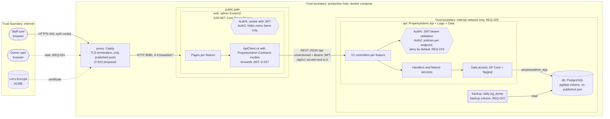
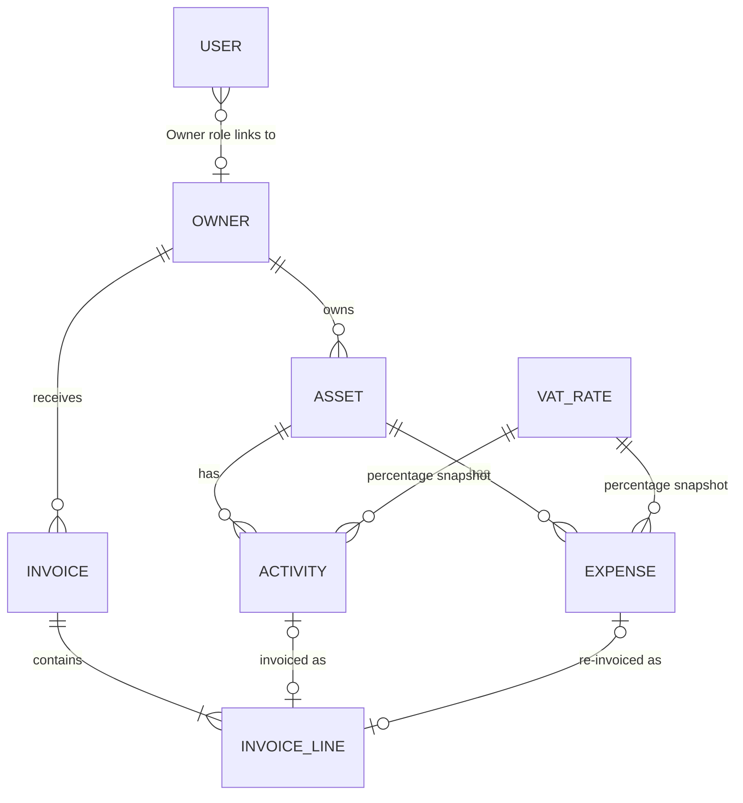

## Requirements

_Owner: architect._ The complete numbered requirements list, written first, before any
architecture. Nothing is designed or built before the user has approved it.

**Approved by the user:** 2026-11-06 (user stories: question 8; scope, languages, roles,
two-factor sign-in and local accounts: questions 9 to 15)

> Restructured by the orchestrator on 2026-11-06 from the earlier "FR-n = US-n" and NFR-1 to
> NFR-6 lines and the user's answers. No requirement was added or changed. The .NET version from
> NFR-1 is a technology choice and moved to Technology versions.

One file per requirement in `requirements/` (type, priority, status, source, acceptance
criteria); the overview `decisions.md` lists them with their status.
- Approved: REQ-001 to REQ-009, REQ-011 to REQ-014, REQ-016 to REQ-021.
- Won't (later): REQ-010 (owner portal), REQ-015 (Excel import).
- Proposed 2026-11-09 and updated 2026-11-10 in T-041 from the user's answers (REQ-022 to
  REQ-026 since approved, see the overview; REQ-027 still Proposed): REQ-022 expected volumes and lists/reports under 2 seconds (Q-033, Q-040); REQ-023
  RPO 24 h / RTO 2 days with same-host backup and accepted host-loss risk (Q-037, Q-039); REQ-024
  seven-year invoice retention and system-proposed, Admin-confirmed anonymization seven years
  after an owner is marked inactive (Q-034, Q-041, Q-044); REQ-025 public frontend over HTTPS
  (Q-035); REQ-026 later off-host backup; REQ-027 hosting up to 1,000 euro per year including
  server, domain and backup storage (Q-042), and separately maintenance up to 100 euro per month
  (Q-046), counting only paid services (licences, external services, no hours), per calendar
  month (Q-048).
- REQ-022: the 2-second criterion is verified once on the production server before go-live,
  with only the fictitious seven-year data set (Q-052); see D-031 and Build task list T9.
- REQ-002, REQ-003 and REQ-009: acceptance criteria recorded on 2026-11-10 from the analyst's
  US-2.1 to US-2.4, US-3.1 to US-3.4 and US-9.1 to US-9.5 (Q-050); the user still confirms them.
- REQ-012: the user chose its "next request" criterion as written (Q-055, option A, 2026-11-10);
  D-034 (Accepted) replaces the last clause of D-005; built in T-058.
- REQ-028 to REQ-030 (approved afterwards, Q-070 to Q-074 and Q-076): supported versions
  (D-012, D-018, D-020; xUnit 2 kept as the one exception, Q-070), the OpenAPI document (D-016)
  and the screen regression tests (D-030). Acceptance criteria recorded 2026-11-11 (T-065); the
  user still confirms them.
- REQ-002 and REQ-003 changed by the user's answer Q-087 (2026-11-11, T-074): owner and asset
  address as five required fields, owner KvK and BTW number optional, owner data on the invoice
  PDF (criteria US-2.1a to US-2.1c and US-3.3a; D-041). Q-088 (2026-11-11, T-075): foreign
  addresses and any EU VAT number format (US-2.1b, US-2.1d); Q-089 (a): the PDF shows the
  owner's current details, no copy on the invoice (US-2.1c). Q-090 done (analyst); Q-091 asks
  the analyst to bring US-2.1 and US-2.5 in step with Q-088 and Q-089.

## Architecture

_Owner: architect._ Starts with the **architecture diagram**, then the layers, components, the
interface contract, the infrastructure, the **Technology versions**, the **Database
architecture**, **Authentication and authorization**, and the task list for the developers.

**Status:** Accepted (user OK 2026-11-06, questions 10 to 15). Based on Analysis US-1 to US-10.

## Architecture diagram

Sign-in: the frontend posts the credentials to `/api/auth/login` (and `login-2fa`; the same
actions are served on `/api/v1/auth/...`); the API checks them against ASP.NET Core Identity and
issues the JWT; the frontend keeps it in its server-side auth cookie. Every API request is
authenticated and authorized in the API. D-037 (accepted, replaces D-026 after Q-075 b): the
backend stays in V1 slices without `PropertyAdmin.Contracts`; the frontend keeps
`PropertyAdmin.Contracts` and the unversioned `/api` routes, which stay on the V1 controllers.
The proxy and the internal-only API follow D-023 and REQ-025 (accepted).

The production host in the diagram is not part of this project (Q-079); the same compose runs
on the user's laptop with Docker Desktop (Q-078). What is checked where is in "Development and
test on the laptop" (D-039, proposed, replaces D-038).

The diagram carries no version numbers: the version of every part is in **Technology versions**
below (2026-11-06, architect: decisions #12 to #20 propose .NET 10 and PostgreSQL 18).

## Layers and components

(decision #1) API (`PropertyAdmin.Api`, `PropertyAdmin.Logic`, `PropertyAdmin.Data`), admin
frontend (Razor Pages, through the API only), `PropertyAdmin.Contracts` (frontend and tests
only, D-037), `PropertyAdmin.Tests`, docker compose; and the business logic (VAT, invoicing,
PDF, localization). Details: [architecture/components.md](architecture/components.md).

## Development and test on the laptop

(D-039.) What is checked where, on the laptop with Docker Desktop (Q-078) or "built, not
verified" (Q-079). Details: [architecture/laptop.md](architecture/laptop.md).

## Technology versions

The version of every technology (newest stable with the longest support, checked on the
vendor's lifecycle page), the end-of-support risks and the upgrade plan for the expected life
(5 years, until about 2031-11): [architecture/technology-versions.md](architecture/technology-versions.md).
In short: .NET 10 LTS (until 2028-11-14, D-012), PostgreSQL 18 (until 2030-11-14, D-015),
.NET images on Ubuntu 26.04 (D-014).

**Code checks with the .NET SDK only (D-051, proposed):** a `Directory.Build.props` in the
repository root switches on the package audit of every restore (`NuGetAudit`, mode `all`;
REQ-028); the SDK analyzers, code style in the build, nullable and an `.editorconfig` follow only
after the user's answer to Q-110. Coverage comes from Microsoft's own collector in
`Microsoft.NET.Test.Sdk`; `coverlet.collector` goes (rule 17). Pieces B19, B20 and T14 in the
Build task list.

## Database architecture

One PostgreSQL database (relational), owned and used only by the API through EF Core (decisions
#1, #3, #24); the entities, address/KvK/BTW rules (D-041), database identities and rights,
volumes and indexes, paging, transactions and `xmin` concurrency, owner data separation,
personal data and anonymization (REQ-024), migrations, and backup and restore (REQ-023):
[architecture/database.md](architecture/database.md).

## Authentication and authorization

(decisions #4, #5, #6; D-034 replaces the last clause of #5) Local accounts with ASP.NET Core
Identity; JWT bearer tokens for the API, a cookie holding the JWT server-side in the admin
frontend; optional two-factor sign-in; several roles per user, permissions as policies enforced
in the API on every request (deny by default, REQ-019). The token rules, the conditions C1 to C6
of D-034, the endpoints without a permission policy, the own-account contract (D-036) and the
**authorization matrix**: [architecture/auth.md](architecture/auth.md).

## Build task list

The pieces for the developers and the tester, each with its owner, story points and the item it
is for (`for:`; one branch and one pull request per item): the first build (B1 to B3, F1 to F3,
T1), the upgrade tasks (U1 to U8), the tasks from the 2026-11-09 checks, the replan after D-026
stopped (T-064), the sprint proposal (T-068), and the owner and asset address pieces with their
interface contract (B13 to B15, F6, F7, T10, T11; T-074, D-041). Details:
[architecture/build-tasks.md](architecture/build-tasks.md).

## API structure

D-037 (replaces D-026): the backend in `V1/<Feature>/<UseCase>/` slices over the Api, Logic
and Data projects; the frontend keeps `PropertyAdmin.Contracts` and the unversioned `/api`
routes. The code before D-026, the target layout and the accepted deviations:
[architecture/api-structure.md](architecture/api-structure.md).

## Error handling

(D-022.) One central handler, RFC 9457 Problem Details, the status and log level per
situation, cancellations as 499 without an error, the report period (D-033). Details:
[architecture/error-handling.md](architecture/error-handling.md).

**JSON body and enums (D-043, proposed; BUG-7, Q-096):** enums travel as numbers in requests
and responses. An unreadable body (wrong JSON type, text for an enum) gives the normal 400
validation Problem Details with a generic message per JSON path, never a .NET type name or
exception text (`AllowInputFormatterExceptionMessages = false`).

**Language of the API messages (D-049, proposed, changed after Q-108):** every API call takes
the optional query parameter `lang` (`nl-NL` or `en-US`; Dutch when absent or unsupported);
`Accept-Language` is not read. The frontend's ApiClient adds it to every call. Contract in
[architecture/error-handling.md](architecture/error-handling.md).
